# Architecture and traceability diagrams

Generated by `uv run python tools/arch.py diagrams --render` from the files in `model/`. Do not edit by hand.

## Viewing the diagrams

- **Pre-rendered images** (this page): `docs/diagrams/*.svg` and `*.png`, regenerated with `uv run python tools/arch.py diagrams --render`.
- **Sources:** `docs/diagrams/*.mmd` (Mermaid text). GitHub and GitLab also render `.mmd` files and ```` ```mermaid ```` blocks natively.
- **Online editor (no install):** https://mermaid.live — paste or open a `.mmd` file; export SVG/PNG.
- **VS Code:** extension *Mermaid Chart* (`MermaidChart.vscode-mermaid-chart`) previews `.mmd` files; *Markdown Preview Mermaid Support* (`bierner.markdown-mermaid`) renders mermaid blocks in Markdown preview.
- **CLI:** `tools/node/node_modules/.bin/mmdc -i docs/diagrams/01_context_components.mmd -o out.svg`.

## Overview by layer

Parts grouped by role; arrows (sender to receiver) aggregate all connections between groups and are labelled with the interface types. Connections inside a group are only shown in the detailed diagram. Shaded groups are outside the system boundary.

[](diagrams/00_overview_layers.svg)

Source: [`00_overview_layers.mmd`](diagrams/00_overview_layers.mmd) · [PNG](diagrams/00_overview_layers.png)

## System context and components (detailed)

All 65 connections, labelled with the interface (port type). Arrows point from the sender of a request or push to its receiver; replies to a call travel back on the same connection. Content returned to the agent is modelled as its own push: servers -> ConfidentialityFilter -> InputGuard. Shaded parts are outside the system boundary. See the overview above for a simplified view.

[](diagrams/01_context_components.svg)

Source: [`01_context_components.mmd`](diagrams/01_context_components.mmd) · [PNG](diagrams/01_context_components.png)

## View: agent-facing path

How the AI agent reaches the servers (through InputGuard), how content is filtered and how confirmations reach the human. Arrows point from the sender of a request or push to its receiver. Shaded parts are outside the system boundary. Port types shown: ConfirmationPort, ContentPort, HumanPort, McpPort. Together the views 01a-01e cover every connection of the detailed diagram 01.

[](diagrams/01a_view_agent_path.svg)

Source: [`01a_view_agent_path.mmd`](diagrams/01a_view_agent_path.mmd) · [PNG](diagrams/01a_view_agent_path.png)

## View: core service calls

Which components use the core services. Arrows point from the sender of a request or push to its receiver. Shaded parts are outside the system boundary. Port types shown: IdPort, ImpactPort, LogPort, RunPort, TraceQueryPort, ViewPort. Together the views 01a-01e cover every connection of the detailed diagram 01.

[](diagrams/01b_view_services.svg)

Source: [`01b_view_services.mmd`](diagrams/01b_view_services.mmd) · [PNG](diagrams/01b_view_services.png)

## View: governance

Human-only governance: review CLI, approvals and gate evaluation. Arrows point from the sender of a request or push to its receiver. Shaded parts are outside the system boundary. Port types shown: ApprovalPort, AuditPort, CliPort, GatePort. Together the views 01a-01e cover every connection of the detailed diagram 01.

[](diagrams/01c_view_governance.svg)

Source: [`01c_view_governance.mmd`](diagrams/01c_view_governance.mmd) · [PNG](diagrams/01c_view_governance.png)

## View: workspace and Git access

All file access goes through WorkspaceGuard; Git operations go to the repository. Arrows point from the sender of a request or push to its receiver. Shaded parts are outside the system boundary. Port types shown: GitPort, WorkspacePort. Together the views 01a-01e cover every connection of the detailed diagram 01.

[](diagrams/01d_view_storage.svg)

Source: [`01d_view_storage.mmd`](diagrams/01d_view_storage.mmd) · [PNG](diagrams/01d_view_storage.png)

## View: operator configuration

Security-relevant settings come only from the operator configuration, never from agent-reachable input (DR-035). Arrows point from the sender of a request or push to its receiver. Shaded parts are outside the system boundary. Port types shown: ConfigPort. Together the views 01a-01e cover every connection of the detailed diagram 01.

[](diagrams/01e_view_operator_config.svg)

Source: [`01e_view_operator_config.mmd`](diagrams/01e_view_operator_config.mmd) · [PNG](diagrams/01e_view_operator_config.png)

## Agent-facing path and human confirmation

All agent traffic passes the input guard; state-changing calls need a human decision from outside the agent session (DR-024, DR-032).

[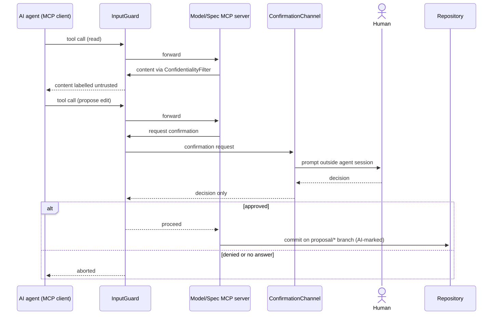](diagrams/02_agent_path_confirmation.svg)

Source: [`02_agent_path_confirmation.mmd`](diagrams/02_agent_path_confirmation.mmd) · [PNG](diagrams/02_agent_path_confirmation.png)

## Approval and gate path (human only)

Approvals are signed git tags; the gate state is derived from them and the trace rules. Reachable only through the review CLI; there is no agent-facing port (DR-012 to DR-018).

[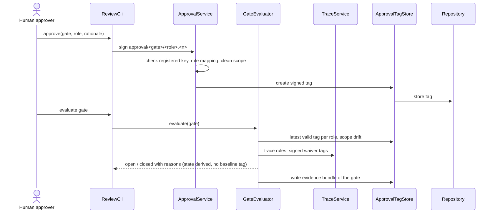](diagrams/03_approval_gate_path.svg)

Source: [`03_approval_gate_path.mmd`](diagrams/03_approval_gate_path.mmd) · [PNG](diagrams/03_approval_gate_path.png)

## Allocation of design requirements to parts

Each design requirement (DR) is satisfied by the part it is connected to.

[](diagrams/04_allocation.svg)

Source: [`04_allocation.mmd`](diagrams/04_allocation.mmd) · [PNG](diagrams/04_allocation.png)

## Needs and the use cases covering them

Use case (UC) covers need (N).

[](diagrams/05_needs_use_cases.svg)

Source: [`05_needs_use_cases.mmd`](diagrams/05_needs_use_cases.mmd) · [PNG](diagrams/05_needs_use_cases.png)

## Needs and the L1 requirements derived from them

L1 system requirement (SR) derives from need (N).

[](diagrams/06_needs_l1.svg)

Source: [`06_needs_l1.mmd`](diagrams/06_needs_l1.mmd) · [PNG](diagrams/06_needs_l1.png)

## Use cases and the L1 requirements they exercise

Use case (UC) exercises L1 requirement (SR).

[](diagrams/07_use_cases_l1.svg)

Source: [`07_use_cases_l1.mmd`](diagrams/07_use_cases_l1.mmd) · [PNG](diagrams/07_use_cases_l1.png)

## L1 requirements and the L2 requirements derived from them

L2 design requirement (DR) derives from L1 requirement (SR).

[](diagrams/08_l1_l2.svg)

Source: [`08_l1_l2.mmd`](diagrams/08_l1_l2.mmd) · [PNG](diagrams/08_l1_l2.png)
