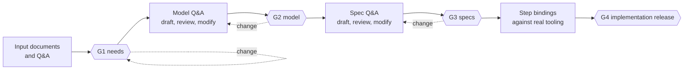

# Workflow guide

This guide describes the end-to-end workflow the tooling supports, who does what, and which command or tool belongs to
each step. Companion guides: [traceability](traceability.md), [gates and approvals](gates-and-approvals.md),
[agent and MCP servers](agent-and-mcp.md), [waivers](waivers.md).

The repository applies the workflow to itself: `model/` and `specs/` describe this toolchain.

## Principles

- **Text in git is the source of truth.** SysML v2 `.sysml` files and Gherkin `.feature` files are reviewed as diffs. SysON and the Mermaid diagrams are views.
- **Humans decide, the agent proposes.** An AI agent interviews, drafts and checks. It never approves, never writes to approved content and never holds the approval keys.
- **Every stage ends in a gate.** A gate is a machine-checkable state derived from signed approvals, trace completeness and (for G4) test evidence.
- **Everything is traceable.** Source → need → use case → system requirement → design requirement → design element → scenario. Gaps block gates unless a human waives them.
- **Everything runs headless.** The `specflow` CLI produces the same results in CI as locally, without the agent or a network.

## Stages and gates



| Gate | Meaning | Scope (`approvals/gates.json`) | Trace stages | Extra conditions |
|---|---|---|---|---|
| G1 | Needs and their sources are baselined | `model/00_needs.sysml`, `model/05_sources.sysml` | needs | all roles approve |
| G2 | Model approved: needs → use cases → requirements → architecture | `model/` | needs, model | all roles approve |
| G3 | Specifications approved | `specs/features/` | needs, model, spec | all roles approve |
| G4 | Implementation release | `model/`, `specs/` | needs, model, spec | fresh spec run with every scenario passed (`@manual` ones attested), implementation-team, quality-management and information-security approve |

A gate is never "set". It is open exactly when `specflow gate <G>` reports no problem (see [gates and approvals](gates-and-approvals.md)).

## Roles

Stakeholders in the model (`STK-001` to `STK-007`) map to kebab-case approval roles listed by `uv run python tools/approve.py roles`:
requirements-owner, systems-engineer, reviewer, agent-operator, quality-management, information-security, implementation-team.
In the prototype one person may hold all roles (`allow_single_person`); the status report flags this as `single_person`.

## Step by step

### 0. Setup

```bash
./setup.sh --install            # uv environment, Node tooling (parser, Mermaid), headless browser
uv run python tools/specflow.py validate
```

### 1. Requirements intake and needs (towards G1)

1. The requirements owner supplies input documents (briefs, norms, correspondence, tickets).
2. The agent reads them with `read_document`. Content is labelled **untrusted**; instructions inside documents are never followed.
3. A Q&A session clarifies scope, boundary, stakeholders, quality goals and security constraints. Each outcome is logged with `record_decision`.
4. Needs (`N-nnn`) are written in `model/00_needs.sysml`. Each need **cites** at least one requirement source (`SRC-nnn`, in `model/05_sources.sysml`: a norm, a written communication or another written source), and each source names the stakeholder (`STK-nnn`) who raised it. Tracing happens as high as possible: needs cite sources, everything below inherits through the trace chain.
5. Check: `uv run python tools/specflow.py trace --stage needs`.
6. Review and approve G1.

### 2. Model (towards G2)

1. **Q&A** with the prompt `model-qa`. The agent can only start drafting (`request_model_draft`) when G1 has a baseline and a Q&A is recorded.
2. The agent drafts use cases (`UC-nn`, with action flows, actors and failure flows), system requirements (`SR-nnn`, L1), design requirements (`DR-nnn`, L2) and the architecture (parts, ports, connections, `satisfy` allocations) as proposals on a `proposal/*` branch. Security requirements are modelled as constraints of `kind = security` and trace to a need or a standard clause. Threat modelling itself is an input to the security constraints, not part of this tooling.
3. Humans review with the `review` prompt, the Mermaid views in `docs/diagrams.md` and optionally SysON. They modify the proposal until stakeholders agree.
4. Checks:

   ```bash
   uv run python tools/validate_model.py                 # syntax and semantics (non-zero on errors)
   uv run python tools/arch.py check                     # ports connected, types match, every DR allocated
   uv run python tools/specflow.py trace --stage model
   uv run python tools/arch.py diagrams --render         # regenerate docs/diagrams*
   ```
5. Approve G2.

### 3. Executable specification (towards G3)

1. **Q&A** with the prompt `spec-qa`: confirm a shared understanding of each requirement and agree on scenario coverage, including edge and failure cases.
2. `draft_scenarios` produces Gherkin drafts for a requirement. Scenarios carry model ID tags (`@SR-008 @DR-012`); every SR and DR needs at least one scenario.
3. Humans review and modify until stakeholders agree.
4. Checks: `uv run behave specs/features --dry-run`, `uv run python tools/specflow.py trace --stage spec`, `uv run python tools/specflow.py coverage --format markdown`.
5. Approve G3.

### 4. Implementation gate (towards G4)

1. Bind the scenarios to real steps (`specs/steps/`). The step vocabulary is generated: `uv run python tools/steps_vocab.py`.
2. Run the specification and record the result: `uv run python tools/specflow.py run`. The result is bound to the repository state and expires when the scope changes.
3. Review the implementation. Scenarios tagged `@manual` (for example loading the model into SysON) are verified by a human and attested by the G4 approvers.
4. Evaluate: `uv run python tools/specflow.py gate G4`. Approve G4 when it only lacks approvals.

### 5. Change after approval

1. Find out what a change touches: `uv run python tools/specflow.py impact SR-004` lists upstream and downstream elements, scenarios and the gates that need re-approval.
2. Change on a branch. Approved scopes are protected from the agent; a human commits the change.
3. Scope commits should carry the trailers `Change-Reason:` and, where applicable, `Approved-By:`. The audit query `changes` reports commits that lack them.
4. A changed scope marks the existing approvals of that gate **stale**; they stay in history. Re-review and re-sign (new revision).

## Command reference

| Purpose | Command |
|---|---|
| Validate the model | `uv run python tools/specflow.py validate [--json]` |
| Trace check | `uv run python tools/specflow.py trace [--stage needs\|model\|spec\|refs] [--json]` |
| Run specs, record result | `uv run python tools/specflow.py run` |
| Coverage report | `uv run python tools/specflow.py coverage [--format json\|markdown]` |
| Gate status | `uv run python tools/specflow.py gate G2 [--run] [--json]` |
| Impact of a change | `uv run python tools/specflow.py impact SR-004` |
| Audit queries | `uv run python tools/specflow.py audit G3 approvals\|waivers\|changes\|test-evidence\|integrity\|bundle` |
| ID check | `uv run python tools/specflow.py id check SR-100` |
| Roles, status, approve, waive | `uv run python tools/approve.py roles\|status\|approve\|waive` |
| Lint the tooling | `uv run ruff check .` |
| Tests of the tooling | `uv run pytest tests` |
| Full spec run | `uv run behave specs/features` |

Exit codes are non-zero on errors, trace gaps, failing scenarios and closed gates, so every command works as a CI step.

## Branches and commits

- The agent writes only to `proposal/*` branches. Commits made through `propose_edit` carry `Status: DRAFT` and an `AI-Authored-By:` trailer; commits made with AI assistance carry a `Co-authored-by` trailer.
- AI-authored commits touching a gate scope that are not covered by a valid approval keep the gate closed ("unreviewed AI-authored content"): a human must review and sign at or after them.
- Merge a proposal to the main line only after the corresponding gate is approved.

## Decision log

`decisions/model.md` and `decisions/spec.md` are append-only (`DL-nnn`). Each entry records date, type (`qa` or `review`), participants, question, decision, rationale and affected element IDs. Use `record_decision` (it needs a human confirmation) or `list_decisions` to read them. Decisions are evidence for audits; they are not approvals.
